# tomar (տոմար)

very simple, pure pascal rss reader without dependencies.

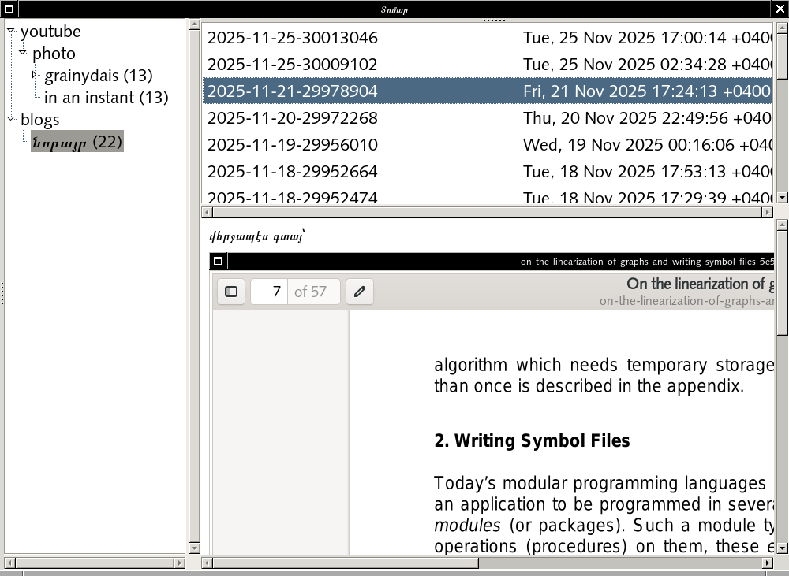


## build

easiest

```
./lazbuild rssreader.lpi
```

apparently it even builds and works in maemo-leste, which makes it very useful there to get youtube links and watch without browser.

we specifically made an effort to handle long press as right click so that it would be useful on mobile devices.

## feed refresh

single-feed, folder and all-feed refresh run in one background `TThread`.
downloads and parsing happen there; database and interface updates stay on the
main thread. cache writes are split into short timer-driven batches, and an
in-memory feed-to-record index avoids scanning the whole cache for each item.
cached articles remain readable during refresh.

adding, deleting, moving and refreshing feeds, as well as marking everything
read, are disabled until the batch finishes. the toolbar follows the same rules.
the status below the tree shows progress and success/failure counts; its tooltip
contains error details. a failed download leaves cached articles intact.
marking a folder read uses cached items without downloading its feeds.

## tests

```
python3 tests/run_feed_refresh_tests.py
```

tests use a local feed server and a temporary home directory, not your feeds or
database. the interface tests require a display or `xvfb-run`.

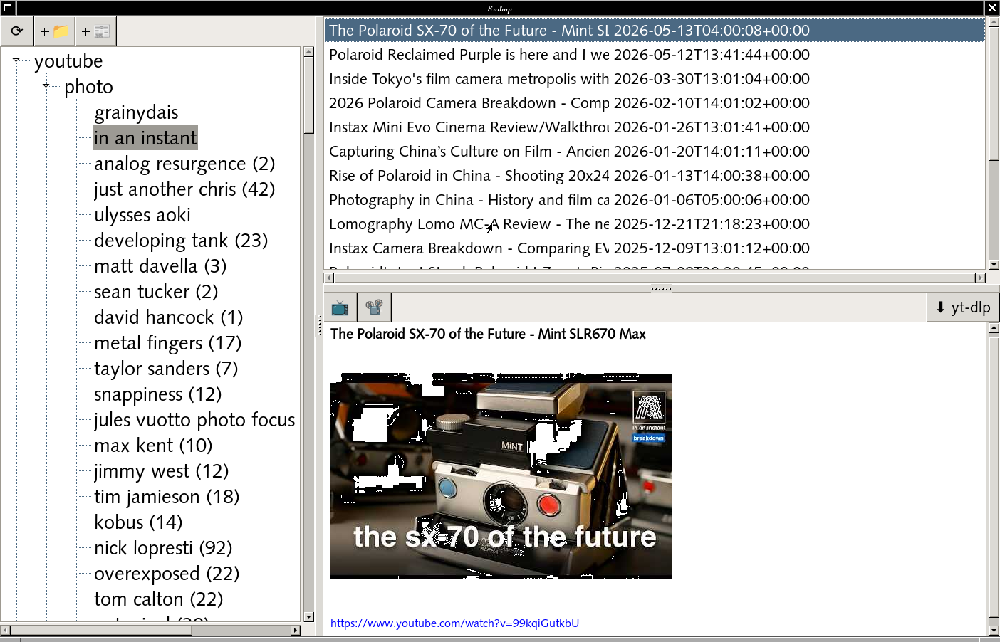

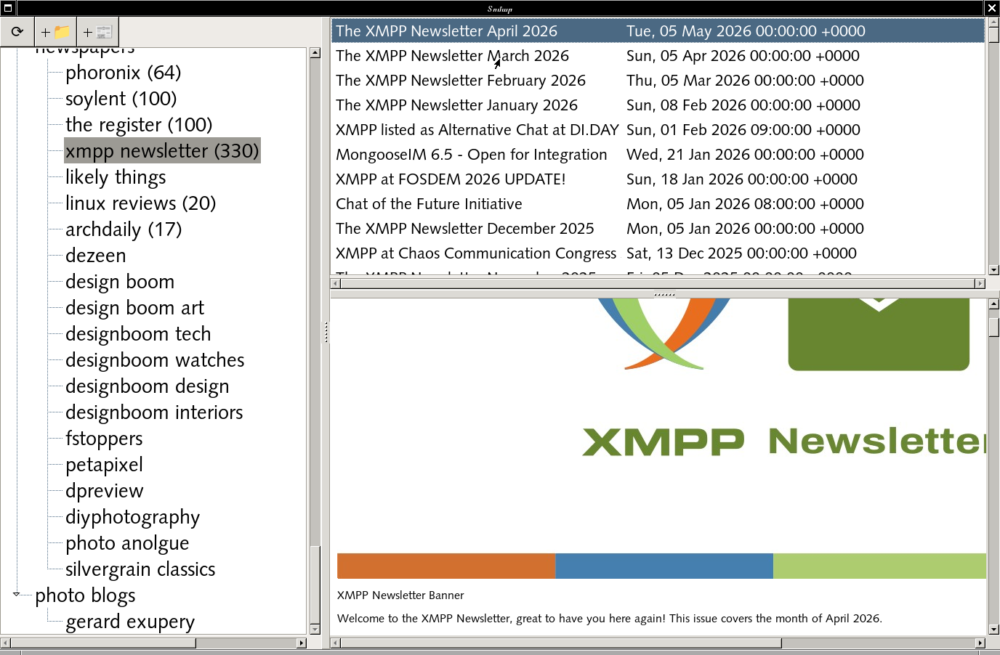

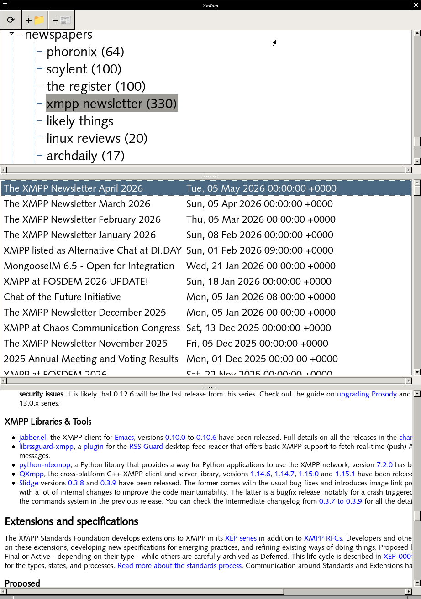

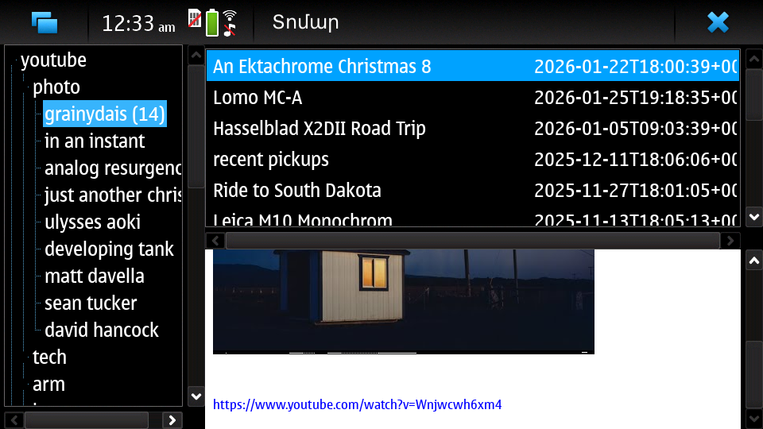

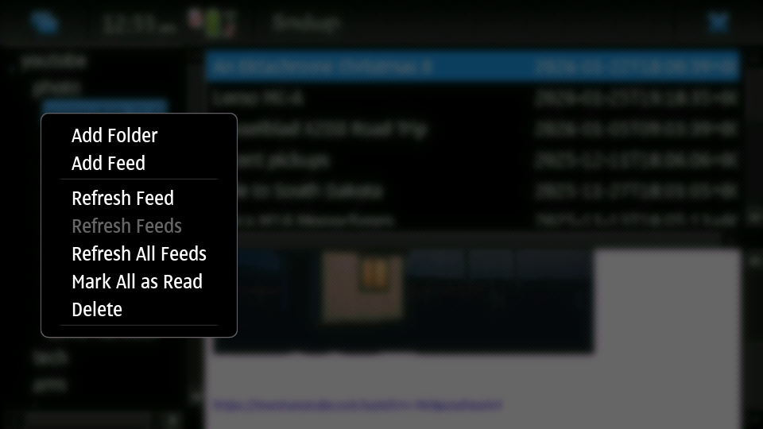

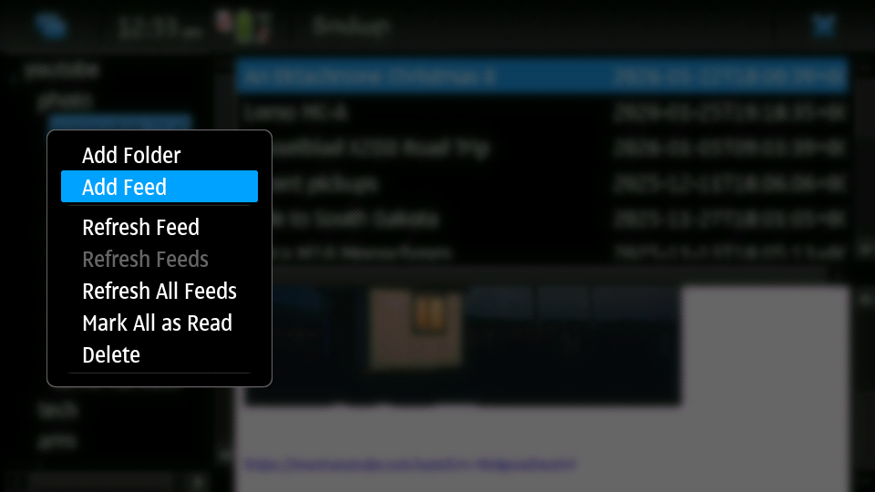

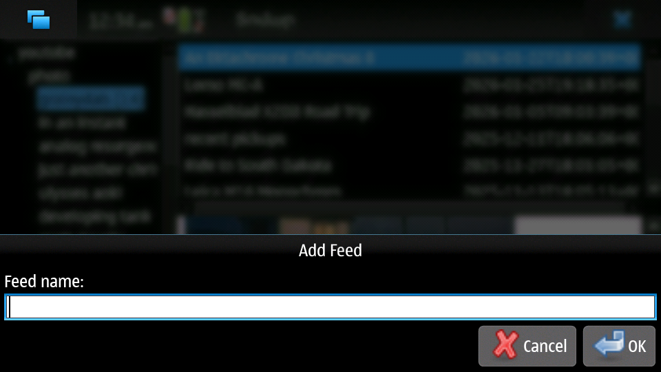

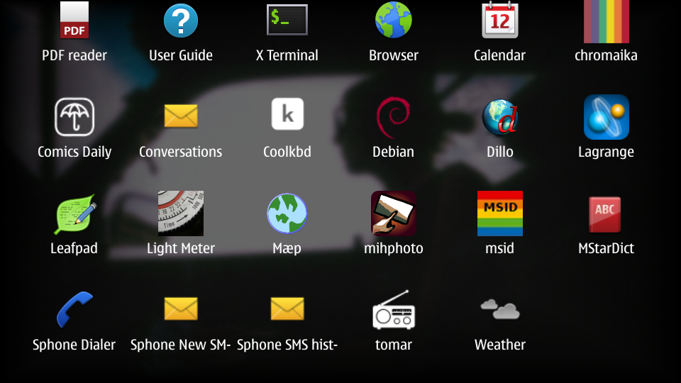

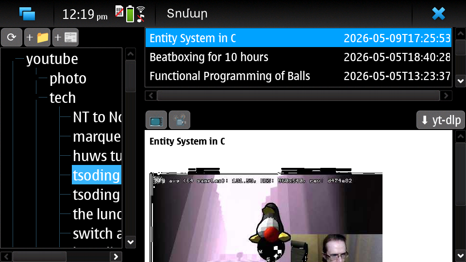

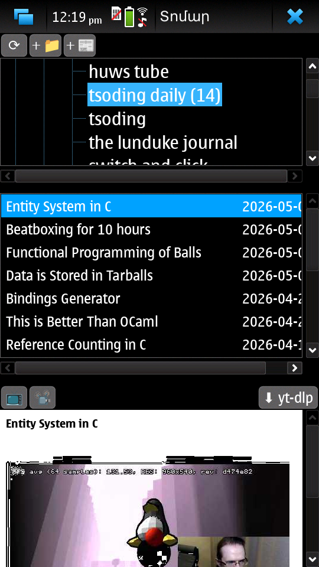
